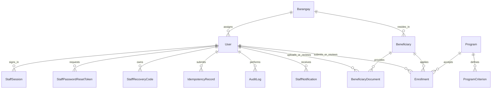
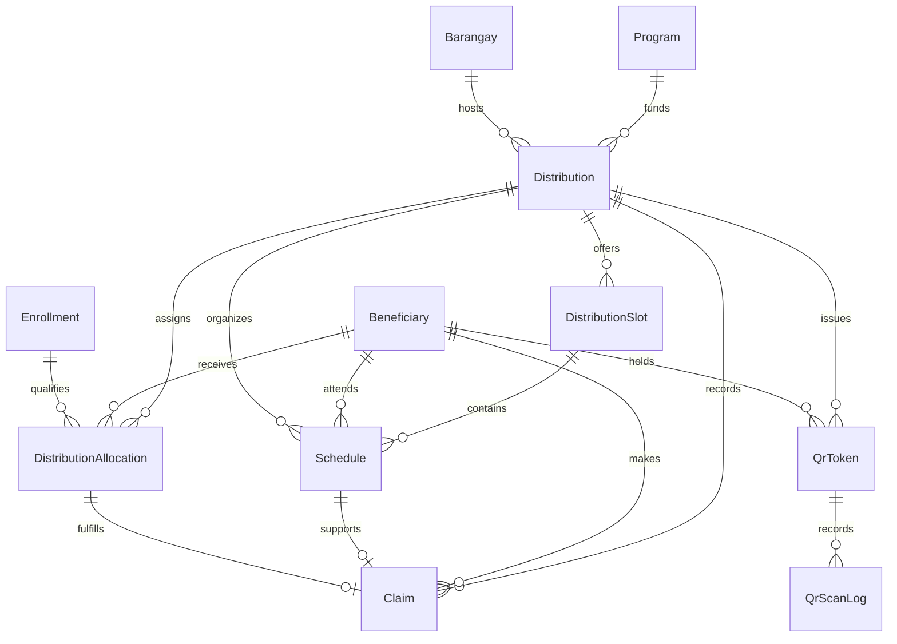
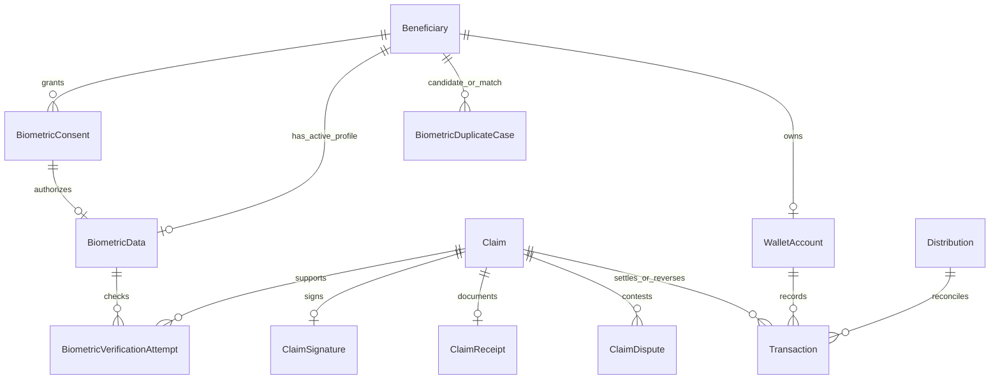
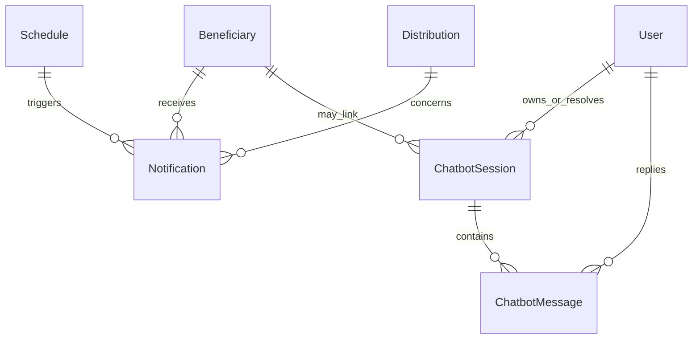

# GarantiyAid staff web system design

This is the implementation description for the capstone manuscript as of 24 September 2026. It covers the staff web application and public help widget. Beneficiary mobile account, mobile push, real payment rails, and government database integrations are outside this release. The [current module matrix](garantiyaid-web-module-matrix-2026-09-24.md), [field-level dictionary](garantiyaid-data-dictionary-2026-09-24.md), and [test record](consultation-test-and-uat-2026-09-24.md) provide the corresponding completion and evidence details.

## Roles and authorization

**System Administrator** manages staff accounts, barangays, distribution events and QR issuance; can view programs and operational records, manage simulated settlement and disputes, independently review duplicate biometric cases, and inspect generic help cases. **DSWD Staff** manages programs and criteria, reviews documents and enrollment eligibility, independently reviews duplicate biometric cases, handles simulated wallet settlement, reporting and linked help cases. **Barangay Facilitator** registers and edits beneficiaries in the assigned barangay, uploads/replaces documents, submits enrollments, manages local schedules, verifies claims and records physical goods release; local help and notification work is also barangay-scoped. A facilitator cannot manage an event or a program merely because they can manage a schedule. Beneficiary-facing mobile functions are deferred.

| Action | Administrator | DSWD Staff | Assigned Facilitator |
| --- | :---: | :---: | :---: |
| Manage staff and barangay records | ✓ | — | — |
| Register/edit beneficiary | ✓ | View | ✓ local |
| Upload/replace beneficiary documents | — | Review | ✓ local |
| Submit program enrollment | — | Review | ✓ local |
| Approve/reject enrollment | — | ✓ | — |
| Browse programs | ✓ | ✓ | ✓ |
| Manage programs, criteria, budgets and status | — | ✓ | — |
| Manage distribution event and allocation | ✓ | View | View local |
| Manage slots and schedules | ✓ | View | ✓ local |
| Issue/revoke QR | ✓ | — | — |
| Verify QR/face/signature claim | ✓ | — | ✓ local |
| Record physical release | — | — | ✓ local |
| View/manage simulated wallet settlement | ✓ | ✓ | — |
| Review biometric duplicate case | ✓ independent | ✓ independent | — |
| View notification history and queue approved notices | ✓ | ✓ | ✓ local |
| Retry failed notification | ✓ | ✓ | — |
| View/reply/resolve linked help case | ✓ | ✓ | ✓ local |
| View generic unlinked help case | ✓ | — | — |
| View detailed financial reports and audit history | ✓ | ✓ | Role-limited |

“Local” requires an active barangay assignment and server-side comparison on every scoped mutation. The frontend hides disallowed controls, but API policy is the authority. The original module-list role ticks for document upload, enrollment, approval, program management, and claim/biometric verification conflict with this separation of duties; replace those ticks in the manuscript table after adviser approval.

## Current entity relationships

These diagrams are split for legibility. They represent the 32 Prisma models; the field dictionary lists the physical columns and constraints. `AuditLog` and `IdempotencyRecord` attach to staff actions across several domains; they are shown once.

## Technology stack

| Layer | Implemented technology | Purpose |
| --- | --- | --- |
| Staff web | React 19, Vite 8, Tailwind CSS 4, native accessible controls, Anime.js 4 | Role-specific screens, responsive navigation and restrained motion. Existing UI components are local; MUI, shadcn/ui, 21st.dev and React Bits are design references, not installed runtime dependencies. |
| API | Node.js 22+, Express 5, Zod 4 | Authenticated REST endpoints, validation, authorization and service logic. |
| Persistence | PostgreSQL, Prisma 7 and `pg` adapter | Relational data, constraints, transactional transitions and migrations. |
| Background work | Redis, BullMQ | Notification queue and workers with bounded retries. Email delivery can use the configured Gmail API; SMS provider currently simulates delivery. |
| Live events | Socket.IO | Authenticated role/barangay rooms; clients refresh only affected views. |
| Biometrics | Remote DeepFace service using ArcFace embeddings and anti-spoofing; local simulated adapter for tests | Consent-gated enrollment, match, duplicate candidate search and verification. |
| Help | Controlled knowledge/intent service, optional external wording assistance | Public process guidance and staff escalation without personal-record access in the public chat. |
| Hosting | Vercel frontend and Railway API in the current deployment arrangement | Separate deployments; database, Redis, worker, mail and remote biometric service require their own healthy configuration. |

## Scheduling logic

The scheduler is **automated and rule-based**, not a trained AI optimizer. For an event in a manageable state, it loads unscheduled active allocations in a stable beneficiary-name order and available slots in start-time order. It counts occupying schedules, checks total capacity, then assigns each beneficiary to the earliest slot with capacity that covers their Sitio/Purok. It increments the queue number and writes all assignments, audit records and an idempotency response in a serializable transaction. Concurrent or repeated requests are rejected or replayed safely. Manual scheduling and later changes use the same capacity and barangay boundaries. The historical database field `assignedByAi` means “assigned automatically” in this implementation; it does not prove model inference. The manuscript should use “automated capacity-aware scheduling” unless an optimization model and evaluation are later added.

## Biometric service logic

An authorized staff member records active consent before enrolling a face. The API sends a transient capture to the remote DeepFace representation endpoint with anti-spoofing enabled, checks that exactly one face and a valid embedding are returned, normalizes the embedding, and encrypts the stored template. It compares a new enrollment against other active profiles whose consent remains valid, excluding the same beneficiary on re-enrollment. A threshold-configured candidate match creates a duplicate case for an independent administrator/DSWD review; it is not an automatic accusation or merge. A database transaction lock prevents concurrent enrollment scans from bypassing one another. Claim verification compares the incoming capture with the selected beneficiary’s template, checks the distribution’s required factors, and records a bounded outcome. Raw captures are not retained as profiles. Revoked or expired consent blocks later use. Simulated mode exercises API logic but cannot validate real-world liveness or demographic accuracy. The implemented processor is DeepFace/ArcFace, not the FastAPI/InsightFace description in the older manuscript.

## Assistance, settlement, and notifications

An event explicitly selects `PHYSICAL_GOODS` or `SIMULATED_WALLET`. In the physical path, a verified claim is released once by the assigned facilitator; claim and allocation become `CLAIMED` together, with evidence, actor and time. Its receipt and reconciliation do not require wallet credit or wallet reversal. In the simulated path, a verified claim can receive one idempotent wallet credit; later closed-loop transfers have matching debit and credit ledger records. No bank, GCash, Maya or government payment rail is connected.

Schedule-created, changed and cancelled messages use controlled templates and staff confirmation. A queued row moves to sent or failed through BullMQ, can be retried by authorized staff, and appears in notification history. The configured SMS adapter is simulated, so its sent status means processing succeeded in the prototype, not that a carrier delivered a text. Beneficiary push awaits the mobile application. Public help gives general process guidance; personal cases are escalated to a role-scoped staff inbox with redacted transcripts, ownership, reply and resolution.

## Manuscript integration map

The original `reference/GarantiyAid - Capstone30 Manuscript.docx` remains the historical adviser copy. Its technology and test claims should be replaced with this implementation description when the consultation results are finalized. Use the module matrix for its feature/role table, the four current relationship diagrams and field dictionary for its ERD/data-dictionary chapter, the role matrix above for staff definitions, and the stack table for its technology chapter. Replace “AI-driven scheduler” claims with the rule-based algorithm above; replace FastAPI/InsightFace claims with the deployed DeepFace/ArcFace adapter description. Insert the dated automated results and pending UAT entries from the test record, then append actual human UAT evidence after the consultation. Do not present pending remote-biometric, Redis, mail, or multi-browser checks as passed.
